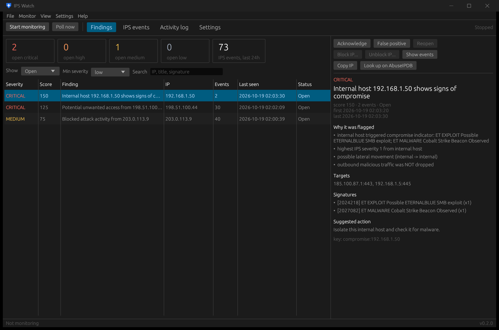
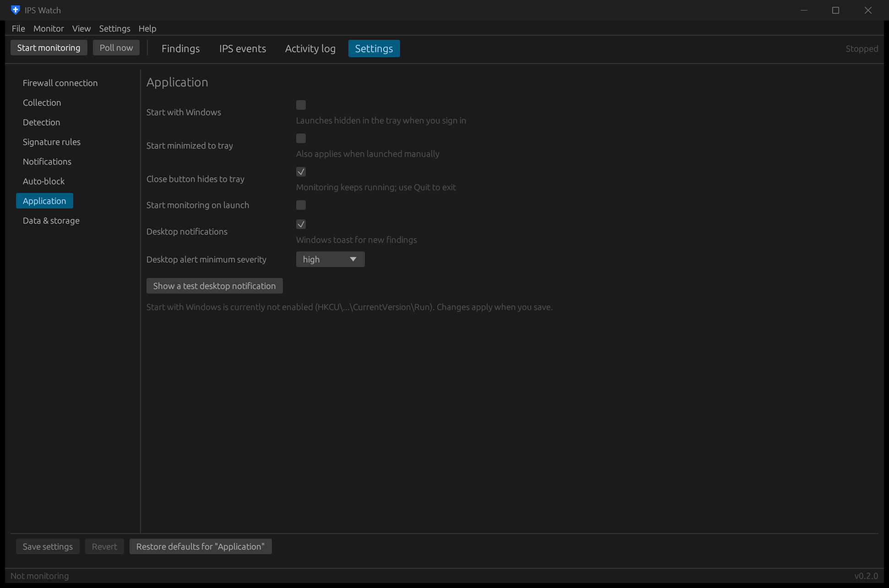

# IPS Watch — OPNsense IPS capture & unwanted-access flagging

A Windows desktop app (plus a command-line build) written in Rust. It collects Suricata IPS
alerts from OPNsense, stores them in SQLite, correlates them with the firewall log, and raises
**findings** when something looks like real unwanted access rather than background noise.

- **System tray**: runs in the background, the tray icon turns red while high/critical findings are open,
  and the right-click menu has Open, Start/Stop monitoring, Poll now, Start with Windows and Quit.
- **Start with Windows**: per-user Run entry (no admin rights), launches hidden in the tray.
- **Settings editor**: every option is editable in the app (Settings tab or the **Settings** menu), with
  validation, Revert, per-section Restore defaults, and test buttons.
- **Alerts**: Windows toast notifications, and optionally Slack/Discord/webhook, ntfy and email.
- **Response**: acknowledge / false positive, block or unblock an IP through a firewall alias, and optional auto-block.
- **Dark mode**: dark by default, with Light and Follow Windows options (View → Theme, the Settings menu, or Settings → Application). The title bar changes too, and exported HTML reports follow the viewer's dark/light preference.
- **Secrets**: the API key, API secret and SMTP password are encrypted with Windows DPAPI.



```
 OPNsense ──(REST API poll: ids/service/query_alerts, firewall log)──┐
          ──(remote syslog: Suricata EVE JSON, optional realtime)────┤
                                                                     ▼
                           normalize → SQLite → detection rules → findings
                                                       │              │
                                        firewall-log correlation      ├─ toast / webhook / ntfy / email
                                                                      └─ block via alias (manual or auto)
```

## Install / build

Download or build `IPSWatch.exe` and run it. It is a single portable file with no installer and no runtime.

```powershell
.\build.ps1          # runs the tests, builds dist\IPSWatch.exe and dist\ipswatch-cli.exe
```

Building needs the Rust toolchain (`rustup`, MSVC target). Settings, the database and the log live in
`%APPDATA%\ipswatch\`.

## First run

1. The app opens on **Settings → Firewall connection**. Enter the firewall URL and API key/secret, then click
   **Test firewall connection** and **Save settings**. Monitoring starts automatically.
2. **Settings → Application**: tick **Start with Windows** (or use the tray menu or the **Settings** menu).
   Closing the window hides it to the tray; use **Quit** in the tray menu or the File menu to exit.
3. To try it without a firewall, use **File → Import eve.json...** with `samples/eve-sample.json`.

| Settings page | What's there |
|---|---|
| Firewall connection | URL, API key/secret, TLS verify / CA file, timeout, poll interval, paging, firewall-log correlation |
| Collection | Realtime syslog receiver: on/off, address, port, UDP/TCP |
| Detection | Internal networks, window, score threshold, brute-force/sweep/port-scan thresholds, sensitive ports, ignored SIDs, trusted sources, re-notify interval |
| Signature rules | Compromise categories and signature keywords |
| Notifications | Webhook (Slack/Discord/generic), ntfy, SMTP; minimum severity; test button |
| Auto-block | Enable, dry run, alias, minimum severity, never-block list |
| Application | Theme (dark / light / follow Windows), start with Windows, start minimized, close to tray, auto-start monitoring, desktop alerts and their minimum severity |
| Data & storage | Database file, event retention, delete old events, delete all data, open data folder |



## Firewall health, exposure, devices and config changes

While monitoring runs, IPS Watch also checks the firewall itself every 5 minutes (adjust this in
*Settings → Health checks*). The **Health** page shows the results. Problems become findings like IPS ones,
with alerts, toasts and the red tray icon, and health problems clear themselves when fixed.

| Check | Raises |
|---|---|
| Gateways (latency / loss per WAN) | gateway down (HIGH), degraded (MEDIUM), all down (CRITICAL) |
| Services | any stopped service (HIGH), unless listed as allowed to be stopped |
| System status, reboots, firmware | crash reporter / system warnings, "firewall rebooted", update available |
| Memory (ZFS cache excluded), state table, disk | above the configured % |
| Reachability | IPS Watch can't reach the firewall API for N minutes (HIGH) |
| **Exposure audit** | each port forward / any-source WAN pass rule / inbound pass seen in the log that's actually open: DNS or sensitive ports HIGH, others LOW (acknowledge the intended ones, and the acknowledgement sticks) |
| **New devices** | a MAC address not seen before in the ARP table (names from DHCP leases); quiet for 24 h after the first scan while it learns |
| **Config changes** | each change in the firewall's configuration history, with who and what (MEDIUM if not made by IPS Watch) |

**CrowdSec** (if the os-crowdsec plugin is installed): the Health page shows whether CrowdSec and its
firewall bouncer are running and checking in, active bans and recent alerts. Alerts for serious scenarios
(brute force on the web GUI/SSH, CVE/exploit attempts) become findings; routine ones like port scans are
only counted. IPS findings from an IP CrowdSec has banned get "CrowdSec has banned this IP" and +20 points.

Findings can be filtered by kind (IPS / Health / Exposure / New devices / Config changes / CrowdSec) and include
*Resolved*. CLI: `ipswatch-cli health` runs every check once and prints a summary.

The API user needs read access to these pages: Gateways, Services, Diagnostics (system, ARP, firewall log),
Firewall rules / NAT, DHCP leases and Configuration history.

## What gets flagged

Events are grouped per actor inside a sliding window (default 15 min) and scored. A finding is raised
at score ≥ 50; severity is medium ≥ 50, high ≥ 80, critical ≥ 120.

**Inbound findings (external source → your network)**

| Signal | Points |
|---|---|
| Highest Suricata severity 1 / 2 / 3 | 40 / 20 / 5 |
| An alert was **not dropped** by the IPS (traffic reached the host) | 30 |
| Targeted a sensitive port (SSH, RDP, SMB, DBs, WinRM, VNC…) | 20 |
| Exploit / malware / privilege-gain signature | 30 |
| ≥ 20 alerts in the window (brute force) | 25 |
| ≥ 10 distinct hosts (sweep) / ≥ 15 distinct ports (port scan) | 25 each |
| **Firewall log shows PASSED connections from the source to internal hosts** | 40 |

Titled *"Potential unwanted access from X"* if traffic got through to a host behind the firewall,
*"Attack attempts against the firewall from X"* if it only hit the firewall's own addresses (no
"reached internal host" points), otherwise *"Blocked attack activity from X"*.

**How noise is kept out**
- **Informational rules are shown but never scored.** These are signatures starting with `OPN_` (app detection),
  `ET INFO`, `GPL ICMP_INFO`, P2P, chat and games. You can edit the list in *Settings → Signature rules*.
- **Ignore a signature in one click.** Right-click an event, or use **Ignore** next to a signature on a finding.
  It's added to the ignored SIDs and your data is re-scored.
- **The firewall's own addresses are recognised automatically.** IPS Watch reads them from the API hourly.
  Traffic *from* them is never scored, because it's the firewall itself or NAT'd/hairpinned client traffic.
- **Severity is worked out from the rule family when the API doesn't send it.** OPNsense's alert API omits
  severity and category, so ET/ETPRO EXPLOIT, MALWARE, TROJAN and CNC count as high, and SCAN, DROP and TOR
  as medium.
- **Firewall-log correlation is strict.** It only counts *inbound* passes inside the alert window, and skips
  broadcast/multicast and routine ports (DNS, DHCP, NTP, NetBIOS, SSDP, mDNS; editable).
- **A banner warns when the IPS hasn't dropped anything for a week.** That means IPS mode is off or no policy is
  set to Drop.
- **Re-score after changing rules.** Use *Settings → Data & storage → Re-score all findings* or
  `ipswatch-cli rescore`. It keeps your acknowledged and false-positive marks.

**Compromise findings (an internal host is the source)**: a trojan/C2/exploit indicator (60),
internal→internal severity ≤ 2 (lateral movement, 30), outbound malicious traffic not dropped (20),
plus the severity/repeat/scan points. These usually matter most: something is already inside.

## OPNsense setup

**Intrusion detection** (*Services → Intrusion Detection → Administration*)
1. Enable it, turn on **IPS mode**, and choose the interfaces: WAN, plus LAN if you want internal, lateral and outbound visibility.
2. Download rule sets (e.g. ET open / abuse.ch). Under *Policy*, set the categories you want blocked to **Drop**.
   In IPS mode only *drop* rules block traffic; IPS Watch treats any alert that wasn't dropped as "reached the host".
3. Optional realtime feed: enable **eve syslog output** (advanced mode), then *System → Settings → Logging → Remote*
   with application `suricata` → this PC, port 5514. Allow that port in Windows Firewall.

**API user** (*System → Access → Users*): create a dedicated user and give it only the Intrusion Detection
and firewall-log privileges, plus *Firewall: Alias* if you'll block IPs. Then create an API key for it.

**HTTPS certificate: do I need a "CA certificate file"?** Not sure? Click **Check certificate** next to the field
(or run `ipswatch-cli check-cert`). It connects to the firewall and tells you which case you're in:

- **Let's Encrypt or another public CA** (you can see this in OPNsense under *Services → ACME Client → Certificates*):
  Windows already trusts it, so leave the CA file **empty** and keep *Verify TLS certificate* ticked. Use the host name
  the certificate was issued for as the Firewall URL (e.g. `https://fw.example.com`), not the IP, because Let's Encrypt can't
  issue certificates for private IPs. The check offers a one-click "Use https://… as Firewall URL". The name must
  resolve to the firewall from your PC; if it doesn't, add an override in *Services → Unbound DNS → Overrides*.
- **Self-signed / OPNsense default certificate**: *System → Settings → Administration → SSL Certificate* shows which
  certificate the web interface uses. Download its CA from *System → Trust → Authorities*. For the default self-signed
  "Web GUI TLS certificate" there is no CA, so download the certificate itself from *System → Trust → Certificates*.
  Download the certificate only, never the private key. Alternatively, install it into Windows (*Trusted Root
  Certification Authorities*, Current User) and leave the field empty.
- Unticking *Verify TLS certificate* works too, but then the connection, including your API key, can be intercepted.
  Use it only to test.

**Drop policy (let the IPS actually block)**: in IPS mode, rules only block when a policy sets them to
*Drop*. IPS Watch can create one policy, "IPS Watch - drop high-risk". It switches the Alert rules in high-risk
rulesets you have enabled (abuse.ch, botcc, compromised, drop/dshield/ciarmy, exploit, exploit_kit,
attack_response, malware, mobile_malware, phishing, coinminer, worm, Snort malware-cnc/backdoor) to Drop.
Everything else stays on Alert. You always get a dry run first that lists every ruleset and rule count, and
nothing changes until you confirm. Use **Set up Drop policy...** (on the banner, or in the Settings menu) or
`ipswatch-cli ips-policy` (dry run) / `--apply --yes` / `--remove --yes`. The rulesets used are editable in
*Settings → Signature rules*. The API user needs the Intrusion Detection privilege.

**Blocking**: create a *Host(s)* alias `ipswatch_block` and a WAN **Block** rule at the top with that alias
as the source. Leave auto-block in dry run until you trust the findings. Internal, private and reserved
addresses, and anything on the never-block list, are never blocked.

## Command line

`ipswatch-cli` uses the same engine and, by default, the same settings file as the desktop app.

```powershell
ipswatch-cli check                          # verify API access
ipswatch-cli run                            # monitor in the foreground
ipswatch-cli poll                           # one pass (Task Scheduler / cron)
ipswatch-cli import samples\eve-sample.json --quiet
ipswatch-cli findings --min high
ipswatch-cli ack inbound:203.0.113.7        # also: fp, reopen
ipswatch-cli report report.html
ipswatch-cli -c path\to\config.toml ...     # use another settings file
```

`deploy/ipswatch.service` runs the CLI as a Linux service.

## Development

```powershell
cargo test                                               # unit + detection/pipeline tests
cargo test --test windows_integration -- --ignored       # toggles the real Run key, shows a toast
cargo run --bin IPSWatch -- --config samples\demo\config.toml --tab settings:application
```

The `--tab findings|events|log|settings[:section]` option opens a specific page. `--minimized` starts in the tray.

History: the first commit is the original Python/Tkinter version. The SQLite schema, the settings file
(including DPAPI-encrypted secrets) and the scoring are compatible with it.
