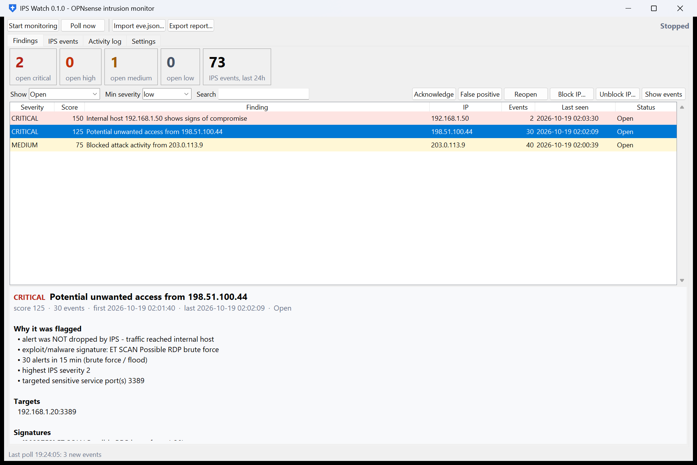

# ipswatch — OPNsense IPS capture & unwanted-access flagging

Collects Suricata IPS alerts from OPNsense, stores them in SQLite, correlates them with the
firewall log, and raises **findings** when something looks like real unwanted access rather than
background internet noise. Findings go to the console, Slack/Discord/webhook, ntfy, or email, and
can optionally auto-block the attacker through a firewall alias.

Pure Python 3.11+ standard library — no packages to install. Comes as a Windows desktop app
(`IPSWatch.exe`) and as a CLI/service. Runs on any box that can reach the
firewall (Linux VM, Raspberry Pi, Windows PC).

```
 OPNsense ──(REST API poll: ids/service/query_alerts, firewall log)──┐
          ──(remote syslog: Suricata EVE JSON, optional realtime)────┤
                                                                     ▼
                           normalize → SQLite → detection rules → findings
                                                       │              │
                                        firewall-log correlation      ├─ notify (webhook / ntfy / email)
                                                                      └─ auto-block via alias (opt-in)
```

## What gets flagged

Events are grouped per actor inside a sliding window (default 15 min) and scored. A finding is
raised at score ≥ 50; severity: medium ≥ 50, high ≥ 80, critical ≥ 120.

**Inbound findings (external source → your network)**

| Signal | Points |
|---|---|
| Suricata severity 1 / 2 / 3 | 40 / 20 / 5 |
| Alert was **not dropped** by the IPS (traffic reached the internal host) | 30 |
| Targeted a sensitive port (SSH, RDP, SMB, DBs, WinRM, VNC…) | 20 |
| Exploit / malware / privilege-gain signature | 30 |
| ≥ 20 alerts in the window (brute force / flood) | 25 |
| ≥ 10 distinct internal hosts (sweep) or ≥ 15 distinct ports (port scan) | 25 each |
| **Firewall log shows PASSED connections from the same source to internal hosts** | 40 |

Titled *"Potential unwanted access from X"* if the traffic got through (not dropped, or the firewall
passed it), otherwise *"Blocked attack activity from X"*.

**Compromise findings (internal host is the *source*)**

| Signal | Points |
|---|---|
| Trojan / C2 / exploit / privilege-gain / info-leak indicator from an internal host | 60 |
| Internal → internal alert of severity ≤ 2 (lateral movement) | 30 |
| Outbound malicious traffic not dropped | 20 |
| Plus the severity / repeat / scan points above | |

These are usually the most important alerts: they suggest something is already inside.

Thresholds, sensitive ports, compromise categories/keywords, ignored SIDs and trusted sources
are all configurable in `config.toml`.

## 1. Configure OPNsense

**Intrusion detection** — *Services → Intrusion Detection → Administration*
1. *Settings*: Enabled ✔, **IPS mode** ✔ (to actually drop), Promiscuous mode if you use VLANs,
   Interfaces: WAN (add LAN too if you want to catch internal/lateral/outbound activity).
2. Turn on advanced mode and enable **Enable eve syslog output** (needed only for the realtime syslog feed).
3. *Download*: enable rule sets (e.g. ET open / abuse.ch), download & update.
4. *Policy*: add a policy that sets action **Drop** for the categories you want blocked. In IPS
   mode only rules with action *drop* block traffic; *alert* rules just log. ipswatch treats any
   alert that wasn't dropped as "traffic reached the host".

**API user** — *System → Access → Users*
1. Create a dedicated user (e.g. `ipswatch`), no shell, no GUI login needed.
2. Grant only the privileges it needs: Intrusion Detection (alert log), the firewall log viewer
   (for correlation), and *Firewall: Alias* edit rights only if you enable auto-block.
3. Create an **API key** for that user; the key/secret file downloads once.

**Optional realtime feed** — *System → Settings → Logging → Remote*
- Add a destination: transport UDP(4) or TCP(4), host = the ipswatch machine, port `5514`,
  applications: `suricata`, level `info`. Set `[syslog] enabled = true` in the config.
- The API poller still runs and fills any gaps (dedupe is automatic).

**Optional auto-block**
1. *Firewall → Aliases*: create alias `ipswatch_block`, type *Host(s)*, empty.
2. *Firewall → Rules → WAN*: add a **Block** rule at the top, source = `ipswatch_block`.
3. In the config set `[block] enabled = true`, leave `dry_run = true` for a week, read the logs,
   then switch it off. Private/reserved IPs and `never_block` entries are never blocked.

## 2a. Windows desktop app



Run `dist\IPSWatch.exe` (build it with `.\build.ps1`) or, from source, double-click `IPSWatch.pyw`.

1. **Settings** tab: enter the firewall URL, API key and secret, then click *Test firewall connection* and *Save settings*.
2. Click **Start monitoring**. New findings at or above the configured severity show a pop-up in the
   bottom-right corner with a sound; click the pop-up to jump to the finding.
3. **Findings** tab: severity counters, a colour-coded list, and a "why it was flagged" panel for the selected finding.
   You can *Acknowledge*, mark it a *False positive*, *Reopen*, *Block IP...* / *Unblock IP...* (adds the IP to or
   removes it from the block alias, after a confirmation), or *Show events*. Right-click an IP to copy it or look it up on AbuseIPDB.
4. **IPS events** tab: the raw alerts, searchable by IP, signature or SID. Red rows weren't dropped by the IPS.
5. **Activity log**: polling, errors, notifications and blocks.

Settings and the database live in `%APPDATA%\ipswatch\`. The API key, API secret and SMTP password are encrypted with Windows
DPAPI, so only your Windows account can read them. If you use the syslog feed, allow the port (default UDP 5514) in Windows
Firewall. To start the app at login, put a shortcut to `IPSWatch.exe` in `shell:startup` and tick
*Start monitoring when the app opens*.

The CLI and GUI share the same engine. To point the CLI at the GUI's settings, use
`python -m ipswatch -c "%APPDATA%\ipswatch\config.toml" findings`.

## 2b. Command line / service

```bash
cp config.example.toml config.toml        # fill in url / api_key / api_secret / notify
python -m ipswatch -c config.toml check   # verify API access
python -m ipswatch -c config.toml run     # continuous monitoring
```

Other commands:

```bash
python -m ipswatch -c config.toml poll                 # single pass (cron / Task Scheduler)
python -m ipswatch -c config.toml findings --min high  # list open findings
python -m ipswatch -c config.toml ack  inbound:203.0.113.7
python -m ipswatch -c config.toml fp   compromise:192.168.1.50   # mark false positive (stays silent)
python -m ipswatch -c config.toml report report.html   # static HTML report
python -m ipswatch -c config.toml import eve.json --quiet       # offline analysis of an exported eve.json
```

As a Linux service: copy the folder to `/opt/ipswatch`, create user `ipswatch`, install
`deploy/ipswatch.service` to `/etc/systemd/system/`, then `systemctl enable --now ipswatch`.
On Windows use Task Scheduler with `python -m ipswatch -c C:\path\config.toml run` at startup.

## Tuning

- First week: set `notify.min_severity = "high"`, review `findings --min medium` daily, add noisy
  SIDs to `ignore_sids`, add trusted scanners (vuln scanners, monitoring) to `ignore_sources`.
- Use `fp <key>` to silence a specific actor permanently; it reopens itself only if you `reopen` it.
- Set `internal_networks` to your real LAN/VLAN/VPN ranges — direction detection depends on it.

## Tests

```bash
python -m unittest discover -s tests -v
```
