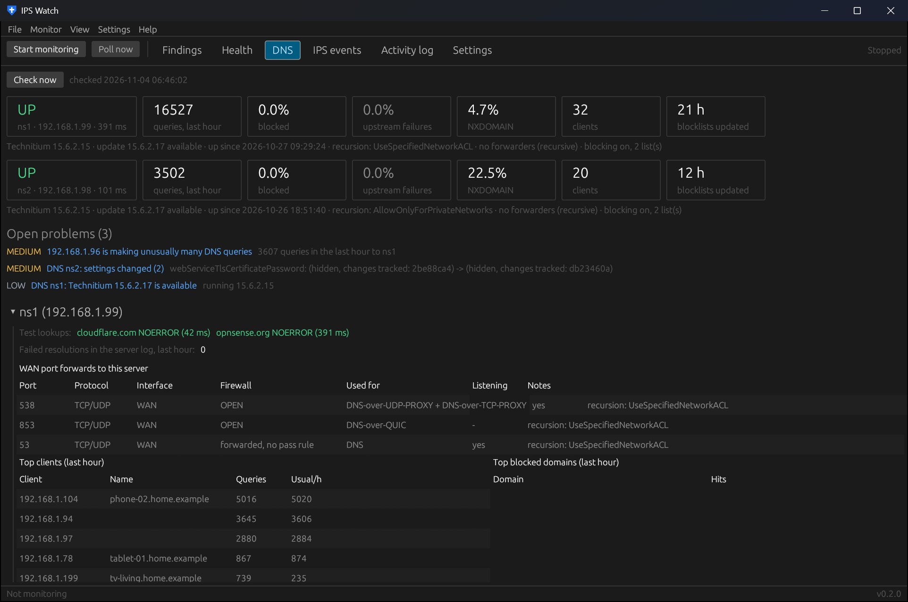

# DNS

The DNS page watches the resolvers your network uses, every 5 minutes by default
(*Settings → DNS servers*). Each server is one of two types:

- **Technitium**: read through its own HTTP API with a token (*Administration → Sessions → Create Token*; a
  read-only user is enough).
- **Unbound (OPNsense)**: the firewall's built-in resolver, read through the firewall API with the same key and
  secret as everything else. No token. Test queries go to the firewall's address unless you enter another one.

## What's shown per server

- A row of tiles: **UP / DOWN** with the response time, queries in the last hour, blocked share, upstream failures
  (SERVFAIL), NXDOMAIN share, number of clients and blocklist age.
- A summary line: version and available update, uptime, recursion setting, forwarders and blocking.
- **Open problems** for that server.
- **Test lookups**: the names asked on every check, with the answer and time.
- **WAN port forwards to this server**, and whether recursion is open to the internet.
- **Top clients** (with their usual hourly rate) and **top blocked domains**.

## Checks

| Check | Technitium | Unbound |
|---|---|---|
| Test lookups on port 53, server down / failover, all down | yes | yes |
| SERVFAIL share (upstream failures) | last hour, from the dashboard | last hour, from the query log; without statistics, from counters between checks (needs *Extended statistics*) |
| Traffic, blocked share, top domains / blocked domains | last hour | last hour (top domains: since statistics started) |
| Unusual clients (query spikes against a learned baseline) | yes | yes (top 10 clients per minute, so counts are lower bounds) |
| NXDOMAIN bursts per client (possible malware / DGA) | needs a query-log app | from the query log (newest 1000 queries) |
| Blocklists empty | yes | yes |
| Blocklist age, update available, zones, upstream-failure log | yes | not available in OPNsense, skipped |
| Settings changes | yes | yes, including overrides, forwarders, access lists and blocklist policies |
| WAN port forwards to the server, open resolver | yes | yes |

{: .note }
For Unbound, most checks need **local statistics**: in OPNsense open *Reporting → Unbound DNS* and enable them in
its settings. While they're off, the DNS page says so and a LOW finding stays open. IPS Watch only sends GET
requests to the DNS servers.

Settings: [Settings → DNS servers](settings.html#dns-servers). CLI equivalent: `ipswatch-cli dns`.
