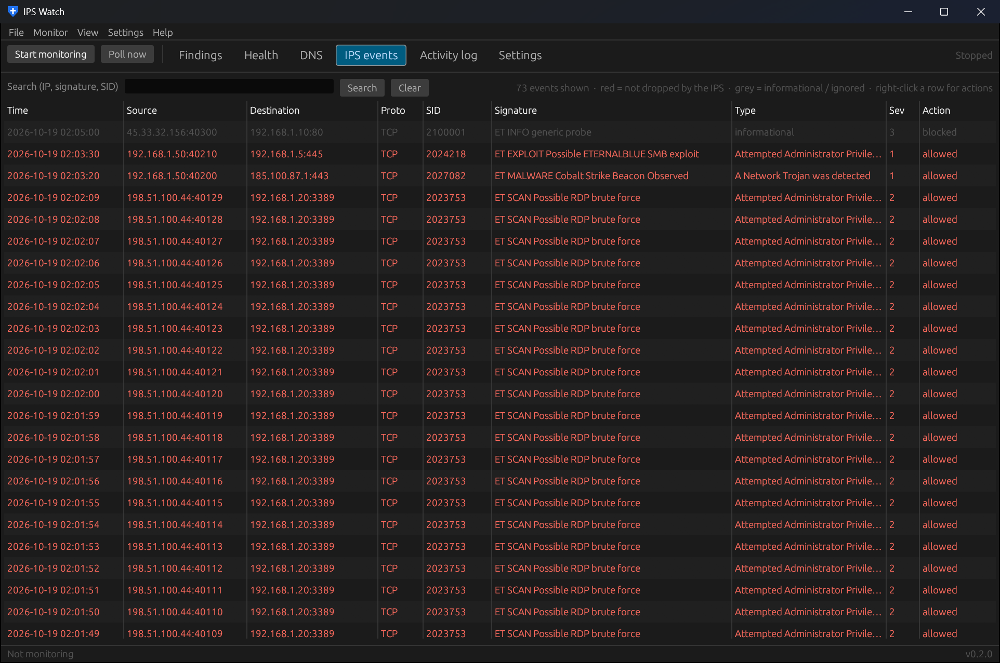
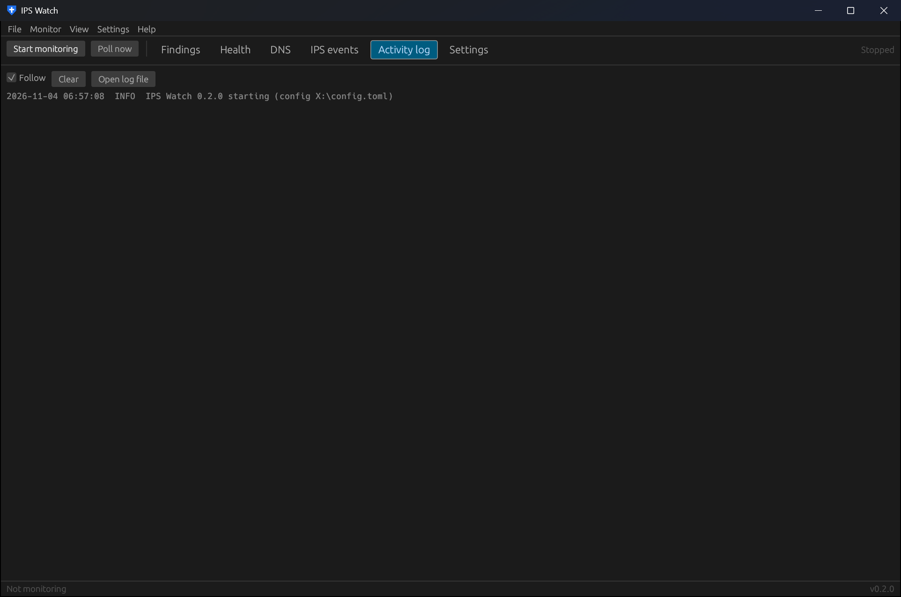

# IPS events and the activity log

## IPS events

Every Suricata alert IPS Watch has stored, newest first: time, source and destination with ports, protocol,
signature ID, signature, classification, severity and the IPS action.

- **Red** rows were **not dropped** by the IPS: the traffic reached its destination.
- **Grey** rows are informational or ignored signatures: shown, but never scored.
- **Search** by IP, signature text or SID.
- **Right-click** a row for Copy source IP, Look up source on AbuseIPDB, and **Ignore signature**, which adds the
  SID to the ignored list and re-scores your findings.

Events are kept for 30 days by default (*Settings → Data & storage*), and at most a million in total.

## Activity log

What the app is doing: polls, checks, notifications, blocks and errors. **Follow** keeps the newest line in view,
**Clear** empties the view (not the file) and **Open log file** opens `ipswatch.log` from the data folder.
