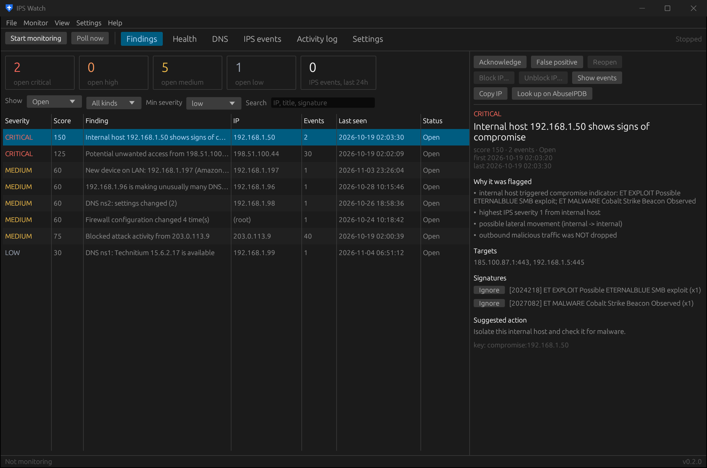

# Findings

The Findings page lists everything IPS Watch thinks deserves a look, newest activity first.

## The counters

The boxes at the top count open findings by severity (critical, high, medium, low) and the IPS events received in
the last 24 hours.

## Filters

| Filter | Options |
|---|---|
| Show | Open, All, Acknowledged, False positive, Resolved |
| Kind | All kinds, IPS, Health, Exposure, New devices, Config changes, DNS, CrowdSec |
| Min severity | low, medium, high, critical |
| Search | IP address, title or signature text |

## The finding details

Select a finding to see, on the right:

- **Why it was flagged**: the scoring reasons (see [How findings are scored](../detection.html)).
- **Targets**: the internal hosts and ports involved.
- **Signatures**: each Suricata rule that fired, with an **Ignore** button that adds its SID to the ignored list and
  re-scores your data.
- **Suggested action** and the finding's **key** (used by the CLI's `ack`, `fp` and `reopen`).

## Actions

| Button | What it does |
|---|---|
| Acknowledge | You've seen it. It leaves the Open list but comes back if the activity escalates. |
| False positive | Not a real problem. It stays silent from now on. |
| Reopen | Undo either of the above. |
| Block IP... / Unblock IP... | Add or remove the source in the firewall's block alias (see [Blocking](../opnsense-setup.html#blocking)). Asks for confirmation. |
| Show events | Jump to the IPS events for this source. |
| Copy IP | Copy the source address. |
| Look up on AbuseIPDB | Open the address on abuseipdb.com in your browser. |

Health, DNS and exposure findings **resolve themselves** when the problem is fixed; you'll see them under
*Show: Resolved*. Acknowledging an intended exposure (for example a port forward to your web server) sticks.

CLI equivalents: `ipswatch-cli findings`, `ack`, `fp`, `reopen` ([commands](../cli/commands.html#findings)).
