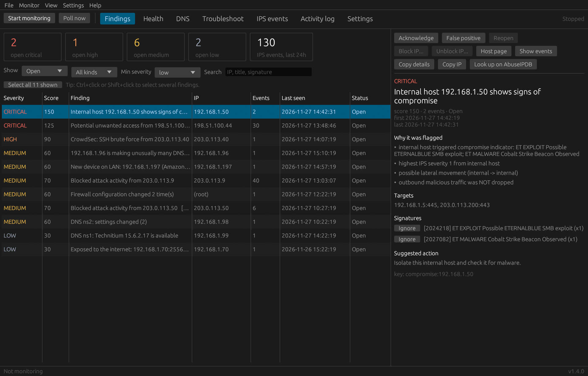
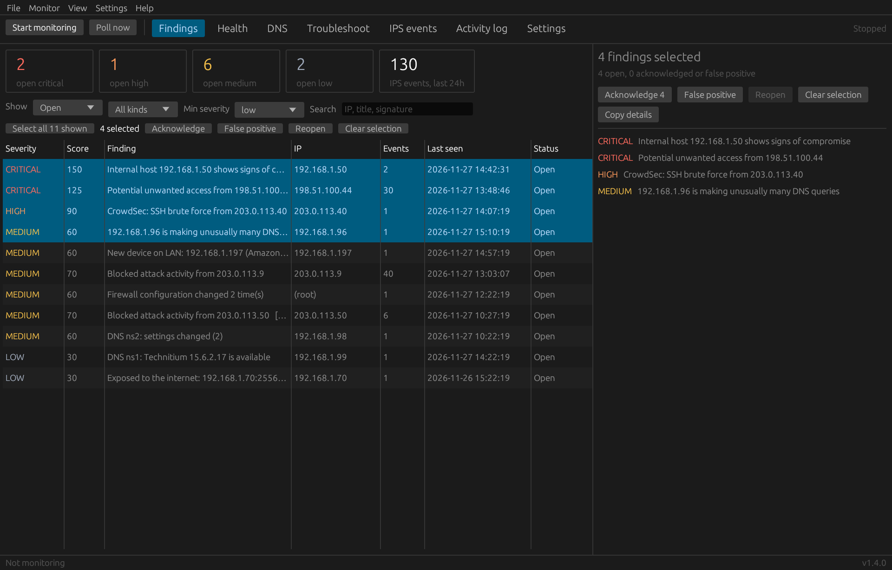
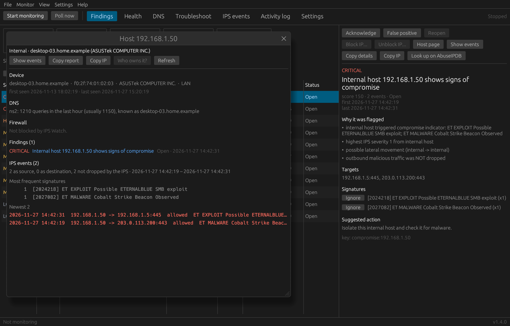

# Findings

The Findings page lists everything IPS Watch thinks deserves a look, newest activity first.

## The counters

The boxes at the top count open findings by severity (critical, high, medium, low) and the IPS events received in
the last 24 hours.

## Filters

| Filter | Options |
|---|---|
| Show | Open, All, Acknowledged, False positive, Resolved |
| Kind | All kinds, IPS, Health, Exposure, New devices, Config changes, DNS, CrowdSec |
| Min severity | low, medium, high, critical |
| Search | IP address, title or signature text |

## The finding details

Select a finding to see, on the right:

- **Why it was flagged**: the scoring reasons (see [How findings are scored](../detection.html)).
- **Targets**: the internal hosts and ports involved.
- **Signatures**: each Suricata rule that fired, with an **Ignore** button that adds its SID to the ignored list and
  re-scores your data.
- **Suggested action** and the finding's **key** (used by the CLI's `ack`, `fp` and `reopen`).

## Actions

| Button | What it does |
|---|---|
| Acknowledge | You've seen it. It leaves the Open list but comes back if the activity escalates. |
| False positive | Not a real problem. It stays silent from now on. |
| Reopen | Undo either of the above. |
| Block IP... / Unblock IP... | Add or remove the source in the firewall's block alias (see [Blocking](../opnsense-setup.html#blocking)). Asks for confirmation. |
| Host page | Everything IPS Watch knows about the address in one window (see [Host page](#host-page)). |
| Show events | Jump to the IPS events for this source. |
| Copy IP | Copy the source address. |
| Look up on AbuseIPDB | Open the address on abuseipdb.com in your browser. |

### Several at once

Select several findings, then acknowledge, mark false positive or reopen them together:

- **Ctrl+click** adds or removes a finding; **Shift+click** selects everything between it and the current one.
- **Select all N shown** (above the list) selects every finding your filters show. Filter first (for example
  *Min severity* or a search for an IP), then select all.

The bar above the list and the right-hand panel then show how many are selected, with **Acknowledge**,
**False positive**, **Reopen** and **Clear selection**. Right-clicking a selected row offers the same.
A plain click goes back to a single finding.

Health, DNS and exposure findings **resolve themselves** when the problem is fixed; you'll see them under
*Show: Resolved*. Acknowledging an intended exposure (for example a port forward to your web server) sticks.

## Host page

**Host page** (on a finding, or right-click a finding or an IPS event, or click an address on the Health page's
device list or the DNS page's client lists) shows everything IPS Watch already knows about one address:

- **What it is**: internal or internet, and the device the firewall sees there (DHCP name, vendor, MAC, interface,
  first and last seen).
- **DNS**: queries in the last hour against its usual rate, the name each DNS server gives it, and NXDOMAIN bursts.
- **Firewall**: blocked by IPS Watch or banned by CrowdSec, always allowed in CrowdSec, and port forwards to it.
- **Findings** about it, in any status, as the source or as a target. Click one to open it.
- **IPS events**: how many, as source and destination, how many weren't dropped, the most frequent signatures and
  the newest events.

**Copy report** copies it all as text. **Who owns it?** (internet addresses only) asks the internet registries
through RDAP who the address is registered to (organisation, network, range, country, abuse contact) and looks up its
DNS name. Only that address is sent, only when you click; see [Security and privacy](../security.html).

CLI equivalents: `ipswatch-cli findings`, `ack`, `fp`, `reopen` ([commands](../cli/commands.html#findings)).
