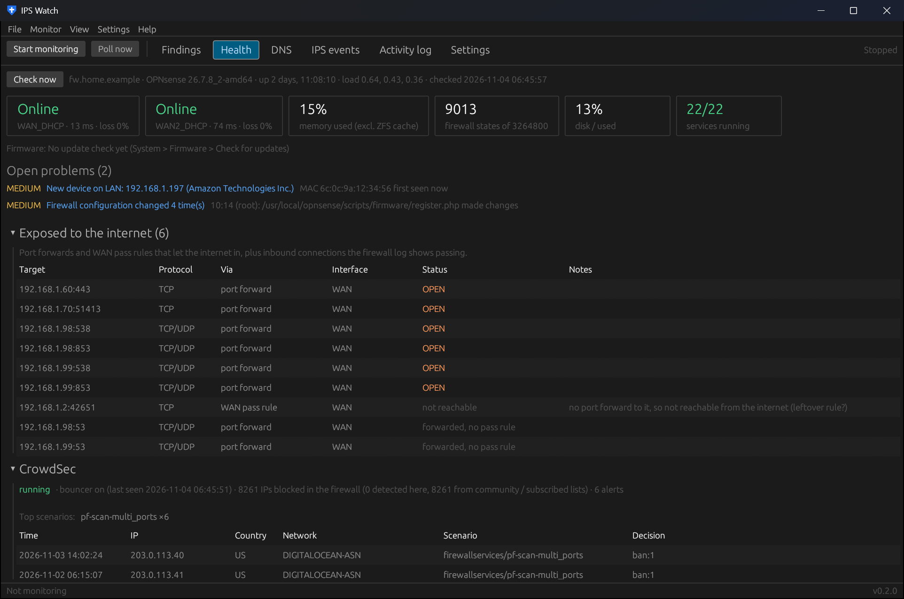

# Health

While monitoring runs, IPS Watch checks the firewall itself every 5 minutes (*Settings → Health checks*). The
Health page shows the latest result, which is kept across restarts; **Check now** runs it immediately. Problems
become findings like IPS ones, with alerts, toasts and the red tray icon, and they clear themselves when fixed.

## Summary line and tiles

The line under **Check now** shows the firewall's host name, OPNsense version, uptime, load and when it was
checked. The tiles show each gateway (status, latency, loss), memory (ZFS cache excluded), firewall states, disk
use and how many services are running.

## Checks

| Check | Raises |
|---|---|
| Gateways (latency / loss per WAN) | gateway down (HIGH), degraded (MEDIUM), all down (CRITICAL) |
| Services | any stopped service (HIGH), unless it's listed as allowed to be stopped |
| System status, reboots, firmware | crash reporter and system warnings, "firewall rebooted", update available |
| Memory, state table, disk | above the configured percentage |
| Reachability | IPS Watch can't reach the firewall API for N minutes (HIGH) |
| **Exposure audit** | each port forward, any-source WAN pass rule or inbound pass in the log that's actually open: DNS or sensitive ports HIGH, others LOW |
| **New devices** | a MAC address not seen before in the ARP table (names from DHCP leases); quiet for the first 24 hours while it learns |
| **Config changes** | each change in the firewall's configuration history, with who and what (MEDIUM unless IPS Watch made it) |

## Exposed to the internet

The table lists every way in from the internet: the target, protocol, how (port forward or WAN pass rule), the
interface and whether it's actually open. Rows like *forwarded, no pass rule* or *not reachable* point at leftover
rules worth cleaning up. Acknowledge the exposures you intend; the acknowledgement sticks.

## CrowdSec

If the os-crowdsec plugin is installed, this section shows whether CrowdSec and its firewall bouncer are running and
checking in, how many IPs are blocked, the top scenarios and recent alerts. Alerts for serious scenarios (brute
force on the web GUI or SSH, CVE / exploit attempts) become findings; routine ones like port scans are only counted.
IPS findings from an IP CrowdSec has banned get "CrowdSec has banned this IP" and +20 points.

### When CrowdSec blocks something you need

CrowdSec's community blocklist holds tens of thousands of addresses, and sometimes one you need is on it, or a
device of yours gets banned. On every health check IPS Watch looks for that and raises a finding when CrowdSec is
blocking:

- **one of your own devices** (a ban on an internal address): HIGH
- **a site on the Troubleshoot "sites that must work" list**: HIGH
- **an address your devices tried to reach** (from the firewall log): MEDIUM

Open the finding to override it:

- **Unblock in CrowdSec...** lifts the ban or blocklist entry now. A blocklist entry can come back with the next
  blocklist download.
- **Always allow...** unblocks it now and adds it to the always-allow list (*Settings → Health checks → Always
  allow*). From then on, IPS Watch lifts any CrowdSec block on that address on every health check and leaves a LOW
  finding saying it did. Networks (CIDR) work too.

Both show what will change and ask first. Turn the alerts off with *Alert when CrowdSec blocks what you need*.
The API user needs the *CrowdSec* privilege and *Diagnostics: PF Table IP addresses* (which edits the blocklist tables) for the overrides.

## Devices and config changes

Further down the page: the devices seen on each interface (IP, MAC, vendor, name, first and last seen) and the
firewall's recent configuration changes.

Thresholds for all of this are under [Settings → Health checks](settings.html#health-checks).
CLI equivalent: `ipswatch-cli health`.
