# Settings (desktop app)
{: .no_toc }

Every option is editable on the **Settings** page, also reachable from the **Settings** menu. Changes are a draft
until you click **Save settings**. **Revert** throws the draft away, and **Restore defaults for "…"** resets only
the section you're looking at (it keeps addresses, keys and tokens). Invalid values are reported in red next to the
buttons and nothing is saved until they're fixed.

Each field below lists its **config key**, so you can find the same setting in `config.toml`; see the
[config file reference](../cli/config-file.html) for the command-line view.

{: .note }
The API key and secret, SMTP password, DNS tokens and webhook / ntfy URLs are encrypted with **Windows DPAPI** when
saved, so only your Windows account can read them.

1. TOC
{:toc}

---

## Firewall connection

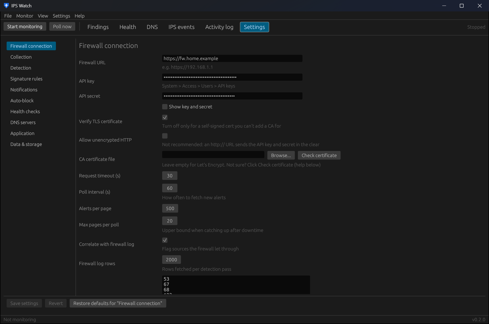

| Field | Default | Config key | Notes |
|---|---|---|---|
| Firewall URL | — | `opnsense.url` | e.g. `https://fw.example.com`. Use the certificate's host name for Let's Encrypt. |
| API key / API secret | — | `opnsense.api_key`, `opnsense.api_secret` | From *System → Access → Users → API keys*. **Show key and secret** reveals them. |
| Verify TLS certificate | on | `opnsense.verify_tls` | Turn off only for a self-signed certificate you can't add a CA for. |
| Allow unencrypted HTTP | off | `opnsense.allow_http` | Needed for an `http://` URL; the key and secret then cross the network in the clear. |
| CA certificate file | empty | `opnsense.ca_file` | Leave empty for Let's Encrypt. **Browse...** picks a file; **Check certificate** tells you whether you need one ([details](../opnsense-setup.html#https-certificate-do-i-need-a-ca-certificate-file)). |
| Request timeout (s) | 30 | `opnsense.timeout_seconds` | 5–300 |
| Poll interval (s) | 60 | `poll_seconds` | How often to fetch new alerts. 10–3600 |
| Alerts per page | 500 | `opnsense.page_size` | 10–5000 |
| Max pages per poll | 20 | `opnsense.max_pages` | Upper bound when catching up after downtime. 1–500 |
| Correlate with firewall log | on | `firewall.correlate` | Flag sources the firewall let through. |
| Firewall log rows | 2000 | `firewall.log_limit` | Rows fetched per detection pass. 100–50000 |
| Ignore ports when correlating | 53, 67, 68, 123, 137, 138, 1900, 5353, 5355 | `firewall.correlate_ignore_ports` | Routine services whose passed traffic isn't counted. |

**Test firewall connection** checks the URL, certificate and API access with the values on the page, saved or not.
Under the button, the firewall's own addresses (detected every hour and treated as internal) are listed.

## Collection

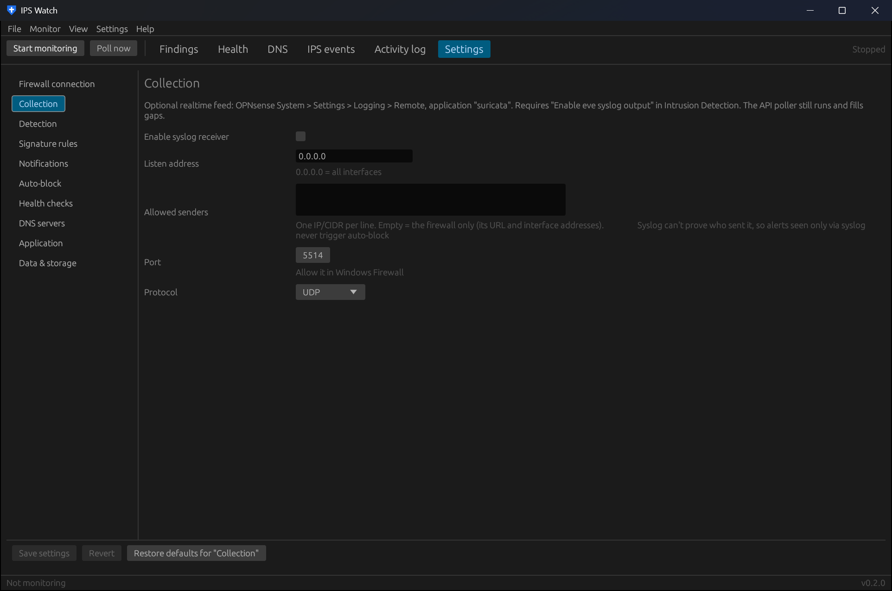

An optional realtime feed alongside the API poller. See [OPNsense setup](../opnsense-setup.html#intrusion-detection)
for the firewall side.

| Field | Default | Config key | Notes |
|---|---|---|---|
| Enable syslog receiver | off | `syslog.enabled` | |
| Listen address | `0.0.0.0` | `syslog.bind` | `0.0.0.0` = all interfaces. |
| Allowed senders | empty | `syslog.allowed_senders` | One IP or CIDR per line. Empty = the firewall only (its URL and interface addresses). |
| Port | 5514 | `syslog.port` | Allow it in Windows Firewall. |
| Protocol | UDP | `syslog.protocol` | UDP or TCP. |

Alerts seen only through syslog never trigger auto-block, because syslog can't prove who sent them.

## Detection

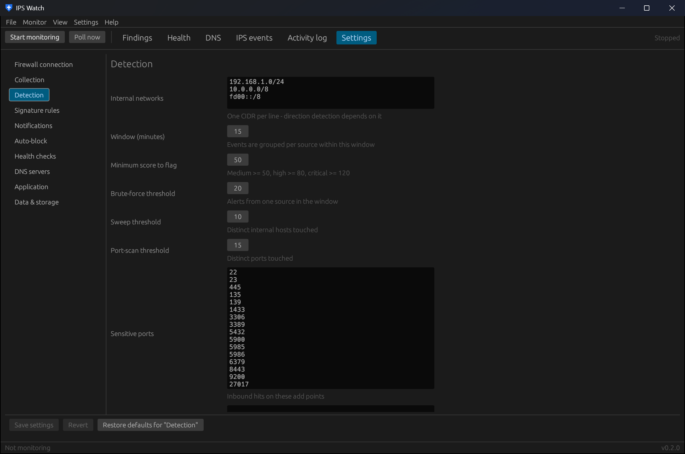

| Field | Default | Config key | Notes |
|---|---|---|---|
| Internal networks | `10.0.0.0/8`, `172.16.0.0/12`, `192.168.0.0/16`, `fd00::/8` | `detect.internal_networks` | One CIDR per line. Direction detection depends on it. |
| Window (minutes) | 15 | `detect.window_minutes` | Events are grouped per source within this window. |
| Minimum score to flag | 50 | `detect.flag_score` | Medium ≥ 50, high ≥ 80, critical ≥ 120. |
| Brute-force threshold | 20 | `detect.repeat_threshold` | Alerts from one source in the window. |
| Sweep threshold | 10 | `detect.scan_hosts_threshold` | Distinct internal hosts touched. |
| Port-scan threshold | 15 | `detect.scan_ports_threshold` | Distinct ports touched. |
| Sensitive ports | 22, 23, 445, 135, 139, 1433, 3306, 3389, 5432, 5900, 5985, 5986, 6379, 8443, 9200, 27017 | `detect.sensitive_ports` | Inbound hits on these add points. |
| Ignored signature IDs | empty | `detect.ignore_sids` | Reviewed noisy SIDs. Also filled by the **Ignore** buttons. |
| Trusted sources | empty | `detect.ignore_sources` | CIDRs never flagged, such as your own scanners. |
| Re-notify after (minutes) | 360 | `detect.renotify_minutes` | Repeat alerts for ongoing activity. |

How these feed the score: [How findings are scored](../detection.html).

## Signature rules

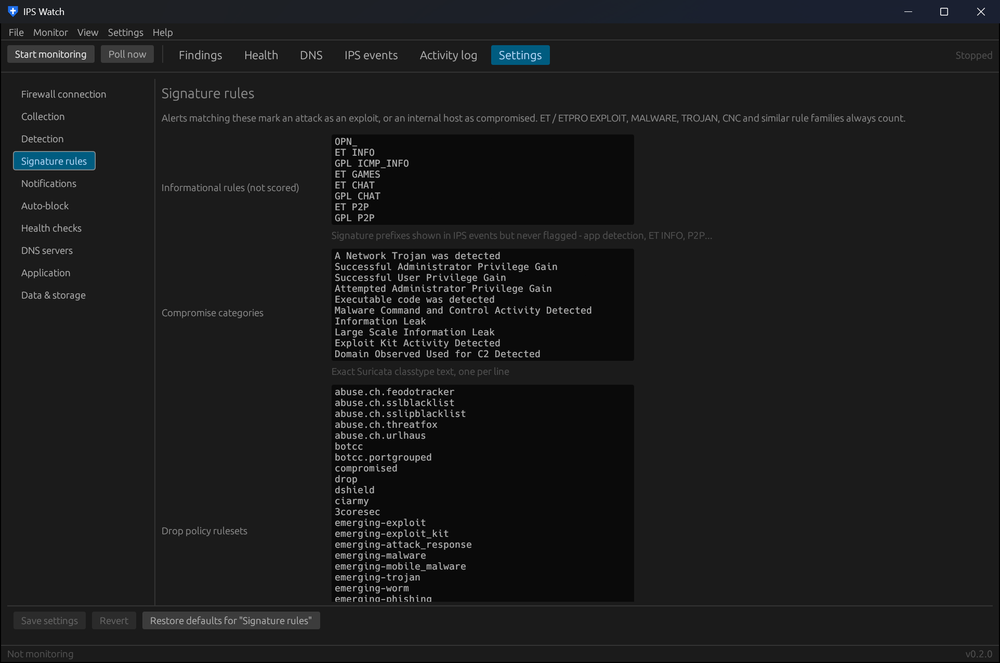

Alerts matching these mark an attack as an exploit, or an internal host as compromised. ET / ETPRO EXPLOIT,
MALWARE, TROJAN, CNC and similar rule families always count.

| Field | Config key | Notes |
|---|---|---|
| Informational rules (not scored) | `detect.informational_prefixes` | Signature prefixes shown but never flagged. Default: `OPN_`, `ET INFO`, `GPL ICMP_INFO`, `ET GAMES`, `ET CHAT`, `GPL CHAT`, `ET P2P`, `GPL P2P`. |
| Compromise categories | `detect.compromise_categories` | Exact Suricata classtype text, one per line. |
| Drop policy rulesets | `ips_policy.rulesets` | Used by **Firewall Drop policy...**: these rulesets' Alert rules become Drop. |
| Signature keywords | `detect.compromise_keywords` | Matched case-insensitively inside the signature (`ET TROJAN`, `Cobalt Strike`, `Mimikatz`…). |

## Notifications

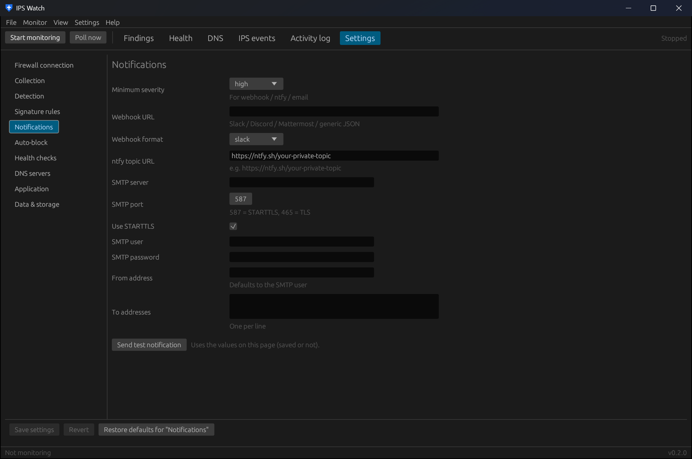

| Field | Default | Config key | Notes |
|---|---|---|---|
| Minimum severity | medium | `notify.min_severity` | For webhook, ntfy and email. |
| Webhook URL | empty | `notify.webhook_url` | Slack, Discord, Mattermost or any endpoint taking JSON. |
| Webhook format | slack | `notify.webhook_format` | `slack`, `discord` or `generic`. |
| ntfy topic URL | empty | `notify.ntfy_url` | e.g. `https://ntfy.sh/your-private-topic`. |
| SMTP server | empty | `notify.smtp_host` | |
| SMTP port | 587 | `notify.smtp_port` | 587 = STARTTLS, 465 = TLS. |
| Use STARTTLS | on | `notify.smtp_starttls` | |
| SMTP user / SMTP password | empty | `notify.smtp_user`, `notify.smtp_password` | |
| From address | empty | `notify.smtp_from` | Defaults to the SMTP user. |
| To addresses | empty | `notify.smtp_to` | One per line. |

**Send test notification** uses the values on the page, saved or not. Desktop toasts are set under
[Application](#application).

## Auto-block

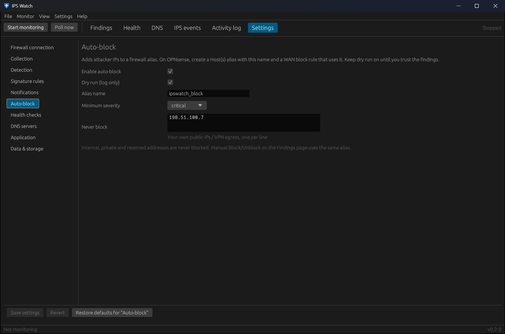

Adds attacker IPs to a firewall alias. On OPNsense, create a *Host(s)* alias with this name and a WAN block rule
that uses it ([Blocking](../opnsense-setup.html#blocking)).

| Field | Default | Config key | Notes |
|---|---|---|---|
| Enable auto-block | off | `block.enabled` | |
| Dry run (log only) | on | `block.dry_run` | Keep it on until you trust the findings. |
| Alias name | `ipswatch_block` | `block.alias` | Also used by manual Block / Unblock on the Findings page. |
| Minimum severity | critical | `block.min_severity` | |
| Never block | empty | `block.never_block` | Your own public IPs and VPN exits, one per line. |

Internal, private and reserved addresses are never blocked.

## Health checks

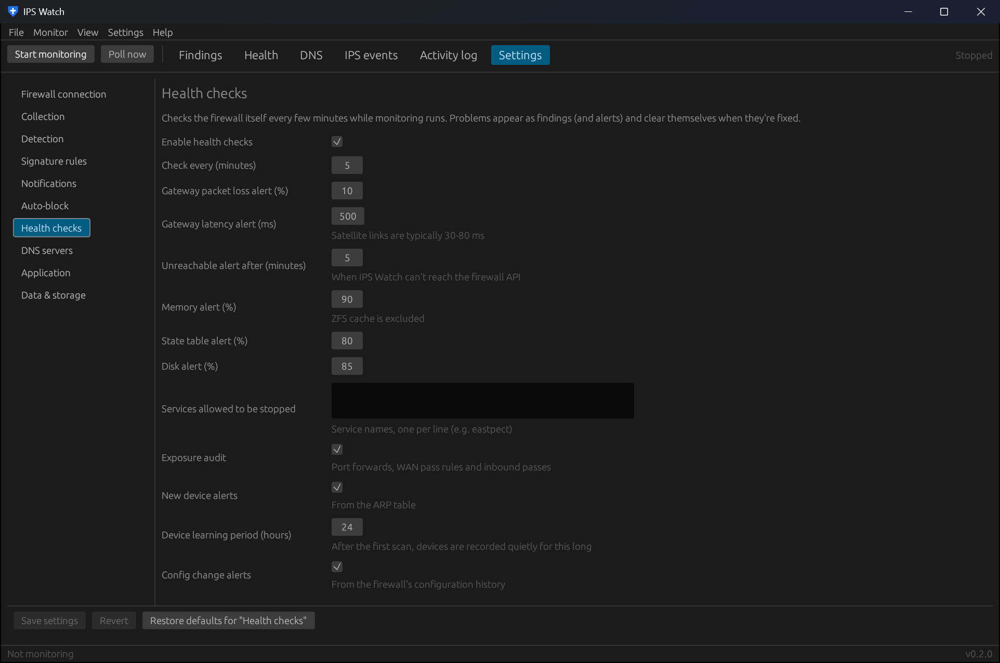

| Field | Default | Config key | Notes |
|---|---|---|---|
| Enable health checks | on | `health.enabled` | |
| Check every (minutes) | 5 | `health.interval_minutes` | 1–120 |
| Gateway packet loss alert (%) | 10 | `health.gateway_loss_pct` | |
| Gateway latency alert (ms) | 500 | `health.gateway_delay_ms` | Satellite links are typically 30–80 ms. |
| Unreachable alert after (minutes) | 5 | `health.offline_minutes` | When IPS Watch can't reach the firewall API. |
| Memory alert (%) | 90 | `health.memory_pct` | ZFS cache is excluded. |
| State table alert (%) | 80 | `health.states_pct` | |
| Disk alert (%) | 85 | `health.disk_pct` | |
| Services allowed to be stopped | empty | `health.ignore_services` | Service names, one per line (e.g. `eastpect`). |
| Exposure audit | on | `health.exposure_audit` | Port forwards, WAN pass rules and inbound passes. |
| New device alerts | on | `health.device_alerts` | From the ARP table. |
| Device learning period (hours) | 24 | `health.device_learning_hours` | After the first scan, devices are recorded quietly for this long. |
| Config change alerts | on | `health.config_alerts` | From the firewall's configuration history. |

**CrowdSec** (same page):

| Field | Default | Config key | Notes |
|---|---|---|---|
| Read CrowdSec | on | `crowdsec.enabled` | Needs the os-crowdsec plugin and an API user allowed to read it. |
| Scenarios that raise findings | `-bf`, `bruteforce`, `cve-`, `exploit`, `backdoor` | `crowdsec.finding_scenarios` | Matched inside the scenario name; others are only counted. |
| Bouncer check-in alert (minutes) | 10 | `crowdsec.bouncer_stale_minutes` | Bans aren't enforced while the bouncer is away. |
| Boost IPS findings from banned IPs | on | `crowdsec.boost_ips` | +20 points and a "CrowdSec has banned this IP" reason. |

## DNS servers

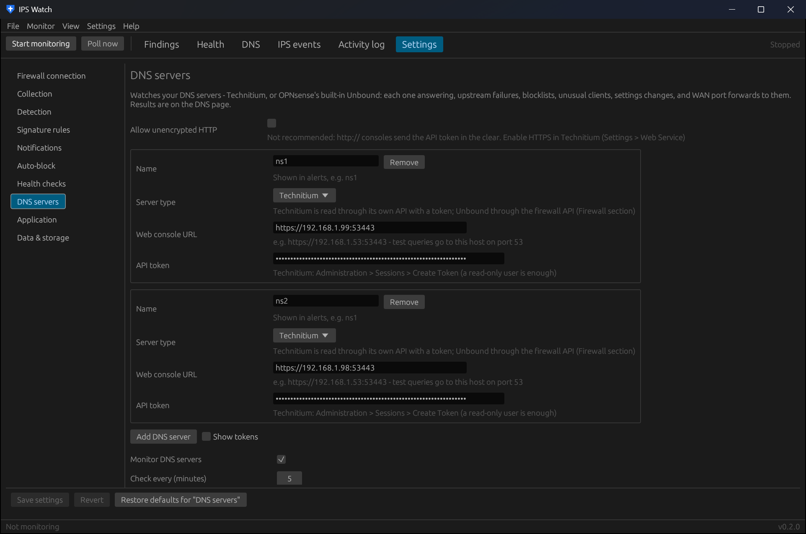

Add one block per server with **Add DNS server**; **Remove** deletes one. **Show tokens** reveals the API tokens.

| Field (per server) | Config key | Notes |
|---|---|---|
| Name | `dns.servers[].name` | Shown in alerts, e.g. `ns1`. |
| Server type | `dns.servers[].kind` | `technitium` or `unbound`. |
| Web console URL (Technitium) | `dns.servers[].url` | e.g. `https://192.168.1.53:53443`. Test queries go to this host on port 53. |
| API token (Technitium) | `dns.servers[].token` | *Administration → Sessions → Create Token*; a read-only user is enough. |
| DNS address (optional, Unbound) | `dns.servers[].url` | Where test queries go on port 53. Empty = the firewall's address. |

An Unbound server uses the firewall API key from *Firewall connection*, so it has no token field:

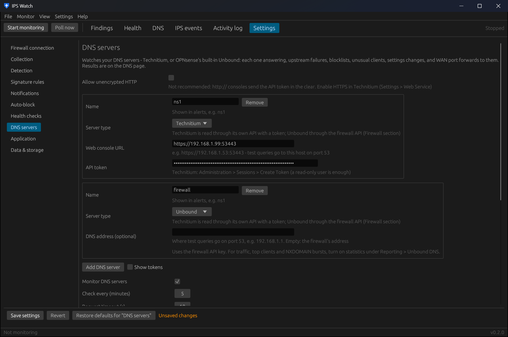

| Field | Default | Config key | Notes |
|---|---|---|---|
| Allow unencrypted HTTP | off | `dns.allow_http` | Needed for `http://` Technitium consoles; the token then crosses the network in the clear. Better: enable HTTPS in Technitium (*Settings → Web Service*). |
| Monitor DNS servers | on | `dns.enabled` | |
| Check every (minutes) | 5 | `dns.interval_minutes` | |
| Request timeout (s) | 10 | `dns.timeout_seconds` | |
| Test lookups | `cloudflare.com`, `opnsense.org` | `dns.test_domains` | Asked of every server on each check; they must resolve. |
| Upstream failure alert (%) | 10 | `dns.servfail_pct` | SERVFAIL share of the last hour's queries. |
| Blocklist age alert (hours) | 48 | `dns.blocklist_max_age_hours` | Technitium only. |
| Busy client threshold (queries/hour) | 3000 | `dns.client_queries_per_hour` | Below this a client is never unusual… |
| Busy client factor | 5 | `dns.client_spike_factor` | …and it must be this many times its usual hourly rate. |
| NXDOMAIN burst (per client per check) | 200 | `dns.nxdomain_burst` | Many lookups of names that don't exist = possible malware (DGA). |
| Zone / settings change alerts | on | `dns.change_alerts` | |

**Test DNS servers** runs the checks once with the values on the page, saved or not.

## Application

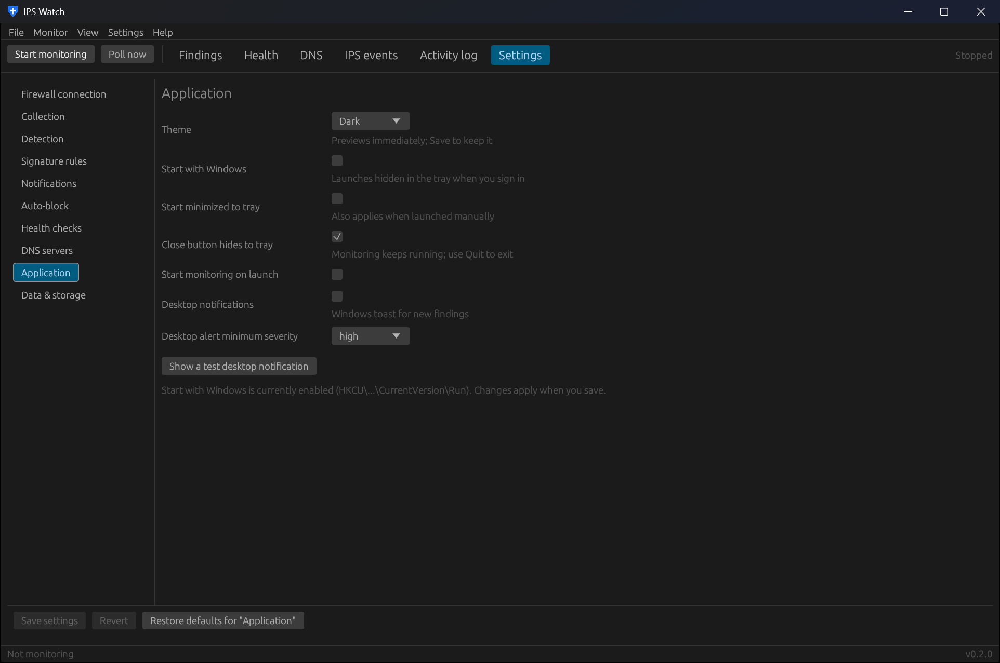

| Field | Default | Config key | Notes |
|---|---|---|---|
| Theme | Dark | `gui.theme` | Dark, Light or Follow Windows (`dark`, `light`, `system`). Previews immediately. |
| Start with Windows | off | `gui.start_with_windows` | Per-user Run entry (no admin rights); starts hidden in the tray. |
| Start minimized to tray | off | `gui.start_minimized` | Also applies when launched by hand. |
| Close button hides to tray | on | `gui.close_to_tray` | Monitoring keeps running; use Quit to exit. |
| Start monitoring on launch | on | `gui.autostart_monitor` | |
| Desktop notifications | on | `gui.desktop_alerts` | Windows toast for new findings. |
| Desktop alert minimum severity | high | `gui.alert_min_severity` | |

**Show a test desktop notification** checks that toasts get through (Focus Assist / Do Not Disturb can hide them).

## Data & storage

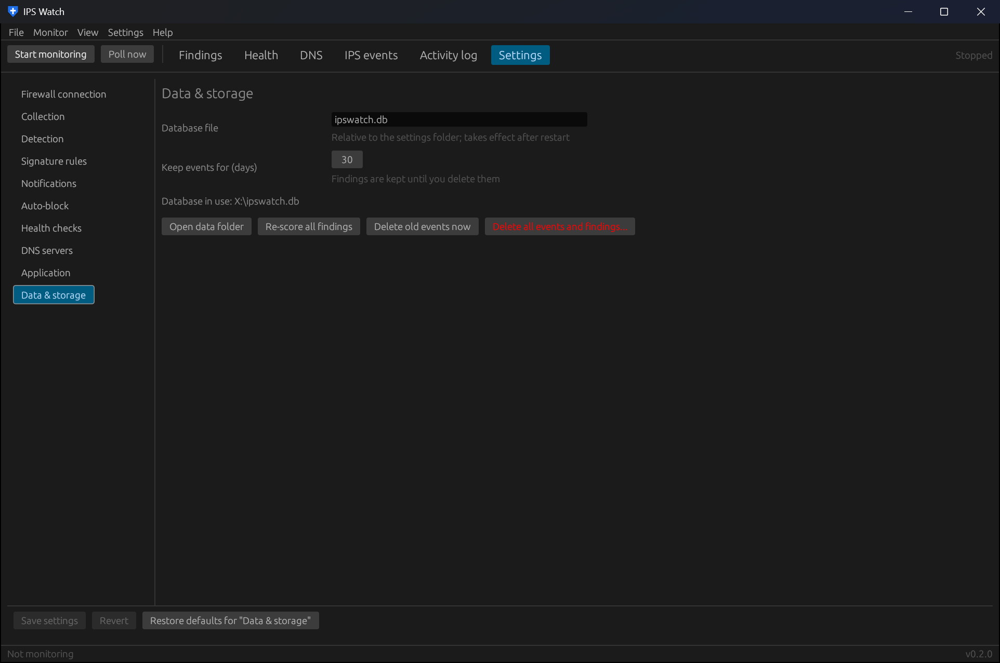

| Field | Default | Config key | Notes |
|---|---|---|---|
| Database file | `ipswatch.db` | `db_path` | Relative to the settings folder. Takes effect after a restart. |
| Keep events for (days) | 30 | `retention_days` | Findings are kept until you delete them. |

| Button | What it does |
|---|---|
| Open data folder | Opens `%APPDATA%\ipswatch` in Explorer. |
| Re-score all findings | Recomputes findings from stored events with the current rules; keeps your acknowledged / false-positive marks. |
| Delete old events now | Applies the retention period immediately. |
| Delete all events and findings... | Starts over (asks first). Settings are kept. |
