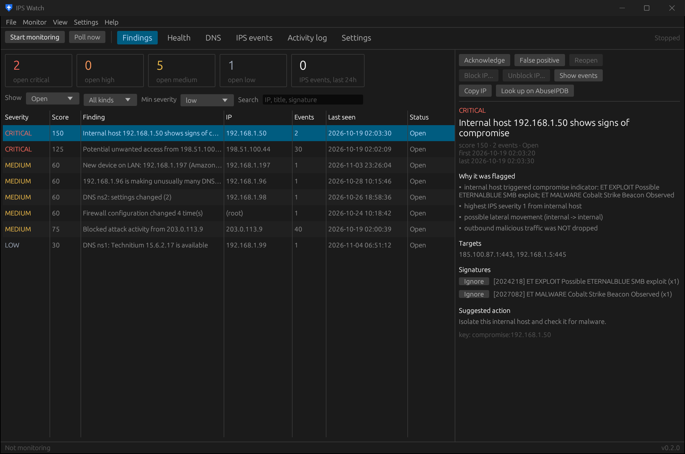

# IPS Watch

IPS Watch is a Windows desktop app (with a command-line build) that collects Suricata IPS alerts from
**OPNsense**, stores them in SQLite, correlates them with the firewall log and raises **findings** when
something looks like real unwanted access rather than background noise. It also watches the firewall's own
health and your DNS servers (Technitium or OPNsense's built-in Unbound).



## What it does

- **Captures IPS alerts** through the OPNsense API (and optionally a realtime syslog feed), and scores them
  per source so a port scan, a brute-force run or a compromised internal host stands out.
- **Correlates with the firewall log**: an alert matters more when the firewall actually let the traffic through.
- **Checks the firewall**: gateways, services, memory, states, disk, reboots, port-forward exposure, new devices
  on the LAN and configuration changes.
- **Watches DNS**: servers answering, upstream failures, blocklists, unusual clients, NXDOMAIN bursts
  (possible malware) and settings changes.
- **Alerts and responds**: Windows toasts, Slack / Discord / webhook, ntfy and email; acknowledge or mark false
  positives; block an IP through a firewall alias, by hand or automatically.
- **Runs quietly**: lives in the system tray, starts with Windows, no admin rights needed.

```
 OPNsense ──(REST API poll: IDS alerts, firewall log, health)──┐
          ──(remote syslog: Suricata EVE JSON, optional)───────┤
 DNS servers ──(Technitium API / Unbound via OPNsense API)─────┤
                                                               ▼
                     normalize → SQLite → detection rules → findings
                                                               │
                                  toast / webhook / ntfy / email, block via alias
```

## Two ways to use it

| | Desktop app (GUI) | Command line (CLI) |
|---|---|---|
| Program | `IPSWatch.exe` | `ipswatch-cli.exe` (Windows), `ipswatch-cli` (Linux) |
| Settings | **Settings** tab, with validation and test buttons | `config.toml` in a text editor |
| Monitoring | Background, from the tray | `run` in the foreground, or `poll` from Task Scheduler / cron / systemd |
| Docs | [Desktop app](gui/) | [Command line](cli/) |

Both use the same engine and, on Windows, the same settings file (`%APPDATA%\ipswatch\config.toml`) and
database, so you can mix them.

## Where to start

1. [Install and first run](install.html)
2. [Set up OPNsense](opnsense-setup.html): IPS mode, an API user, and optionally a Drop policy and a block alias
3. Tune it: [GUI settings](gui/settings.html) or the [config file reference](cli/config-file.html)
4. Learn [how findings are scored](detection.html)
