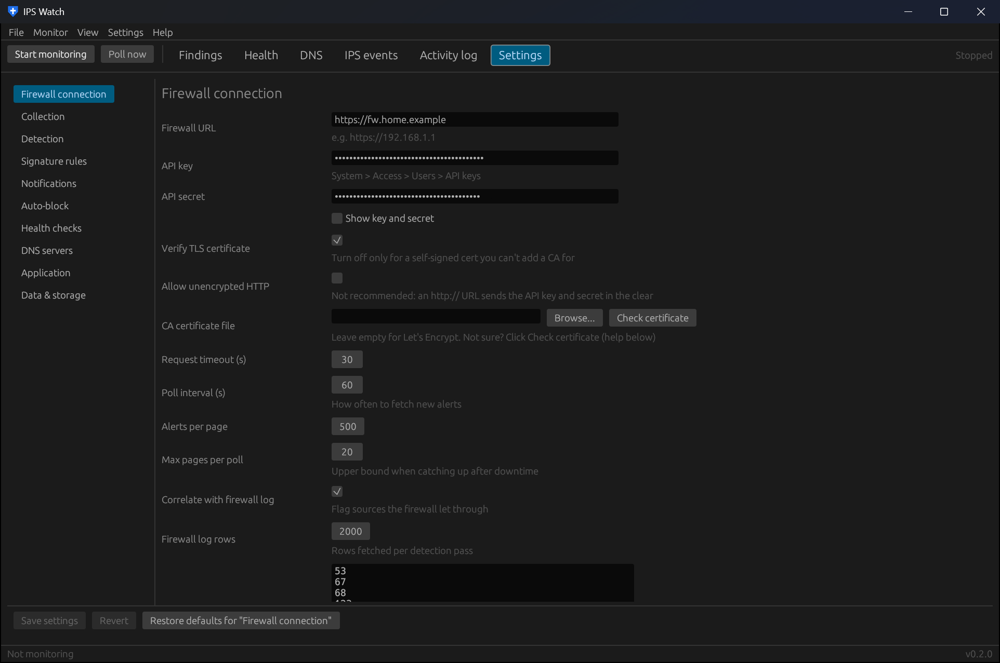

# Install and first run
{: .no_toc }

1. TOC
{:toc}

## Requirements

- Windows 10 or 11 (64-bit) for the desktop app. The CLI also builds and runs on Linux.
- OPNsense with Intrusion Detection enabled, and an API key for a user with the right privileges
  (see [OPNsense setup](opnsense-setup.html)).
- Optional: Technitium DNS servers, or OPNsense's Unbound, for the DNS checks.

## Install the desktop app

Run `IPSWatch-Setup-<version>.exe`.

- It installs for **your Windows account only** (no admin rights) into `%LOCALAPPDATA%\Programs\IPS Watch`,
  adds a Start menu entry, and shows up in *Settings → Apps* for uninstalling.
- Running a newer installer upgrades in place: it closes the running copy and starts the new one.
- Uninstalling keeps your settings and history in `%APPDATA%\ipswatch\`.
- `IPSWatch.exe` also runs on its own as a portable file.

## Build from source

You need the Rust toolchain (`rustup`, MSVC target). For the installer you also need Inno Setup 6
(`winget install JRSoftware.InnoSetup`).

```powershell
.\build.ps1
# runs the tests, builds dist\IPSWatch.exe and dist\ipswatch-cli.exe,
# and (with Inno Setup 6 installed) dist\IPSWatch-Setup-<version>.exe
```

On Linux, build only the CLI:

```bash
cargo build --release --no-default-features --bin ipswatch-cli
```

## First run (desktop app)

1. The app opens on **Settings → Firewall connection**. Enter the firewall URL and API key and secret, click
   **Test firewall connection**, then **Save settings**. Monitoring starts on its own.
2. Under **Settings → Application**, tick **Start with Windows** (also in the tray menu and the **Settings** menu).
   Closing the window hides it to the tray; use **Quit** in the tray menu or **File → Quit** to exit.
3. Optional: add your DNS servers under **Settings → DNS servers**, and notifications under **Settings → Notifications**.

To try it without a firewall, use **File → Import eve.json...** with `samples/eve-sample.json` from the repository.



## First run (command line)

```powershell
notepad $env:APPDATA\ipswatch\config.toml   # set [opnsense] url, api_key, api_secret
ipswatch-cli check                          # verify API access and IDS status
ipswatch-cli run                            # monitor in the foreground (Ctrl+C to stop)
```

The CLI reads the same settings file as the app. The first time the desktop app saves it, the secrets are
encrypted with DPAPI; the CLI reads both encrypted and plain values. See the
[config file reference](cli/config-file.html) for every option.

## Where things are stored

| What | Where (Windows) |
|---|---|
| Settings | `%APPDATA%\ipswatch\config.toml` |
| Database (events, findings, devices) | `%APPDATA%\ipswatch\ipswatch.db` |
| Daily database backups (7 kept) | `%APPDATA%\ipswatch\backups\` |
| Log | `%APPDATA%\ipswatch\ipswatch.log` |
| Program | `%LOCALAPPDATA%\Programs\IPS Watch\` |

If the database is ever damaged (for example by a forced reboot), IPS Watch repairs it on start from the newest
backup plus whatever it can salvage, keeps the damaged files in a `damaged-<time>` folder, and tells you with a
notification.
